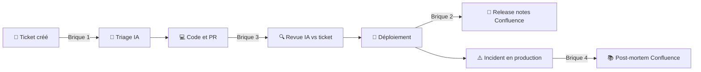

# 🤖 POC Atlassian + IA

> Accompagner le cycle de vie d'un projet technique avec **Jira**, **Confluence**, le **CI/CD** et l'**IA**, du ticket à l'incident en production.


---

## 💡 L'idée en une phrase

Montrer comment Jira, Confluence, les outils CI/CD et l'IA travaillent ensemble pour accompagner un ticket de sa création jusqu'à l'incident, avec **le minimum de saisie manuelle** et **le maximum de traçabilité**.

Plutôt que des démos isolées, le POC déroule un **fil rouge** : le cycle de vie complet d'un ticket.

> ℹ️ Les exemples de ce document sont fictifs et servent à illustrer. Ce ne sont pas des résultats mesurés chez un client.

---

## 🎯 Pourquoi ce POC

Les équipes IT et engineering des grands comptes perdent du temps sur les mêmes irritants :

- 📝 Des tickets mal rédigés, incomplets ou en doublon
- 🔄 Des statuts Jira qui ne reflètent pas la réalité du code et des déploiements
- 📄 Des release notes et de la documentation écrites à la main, souvent en retard
- 🚨 Des post-mortems rédigés des jours après l'incident, ou jamais
- 🧩 Une information éclatée entre Jira, Confluence, Git et la supervision

L'objectif : des réponses concrètes, démontrables en quelques minutes, sur des outils que les clients utilisent déjà.

---

## 🗺️ Le fil rouge



---

## 🧱 Les 4 briques

### 1️⃣ Triage IA des tickets

| | |
|---|---|
| **Ce qu'on fait** | A la création d'un ticket, ScriptRunner envoie le contenu à Claude. L'IA propose une priorité, des labels, un composant, détecte les doublons probables et reformule en critères d'acceptation. Le résultat revient en commentaire dans le ticket. |
| **Pourquoi c'est bien** | Effet visible en quelques secondes : un ticket flou devient exploitable. |
| **Ce que ça résout** | Tickets incomplets, qualité hétérogène, temps perdu en allers-retours et en tri manuel. |

**Exemple**
- ❌ **Avant** : ticket "ça marche pas le paiement", le chef de projet doit rappeler l'auteur pour comprendre.
- ✅ **Après** : l'IA reformule ("Echec du paiement par carte à la validation du panier"), propose la priorité Haute, repère un doublon (PI-12) et liste les questions à poser. Validation humaine en 30 secondes.

### 2️⃣ Jira + CI/CD : livraison tracée de bout en bout

| | |
|---|---|
| **Ce qu'on fait** | Les statuts Jira avancent seuls grâce au natif Atlassian (GitHub for Jira + Jira Automation), sans une ligne de code. Le statut de déploiement remonte dans Jira. A chaque release, l'IA génère les release notes depuis les PR fusionnées et les publie dans Confluence. |
| **Pourquoi c'est bien** | Zéro ressaisie : le code, le ticket et la documentation restent alignés. |
| **Ce que ça résout** | Statuts Jira périmés, traçabilité incomplète (audit, conformité), release notes écrites à la main. |

**Exemple**
- ❌ **Avant** : le développeur oublie de mettre à jour le ticket, les notes de version se rédigent à la main en fin de mois.
- ✅ **Après** : branche ouverte = "En cours", PR ouverte = "En revue", PR fusionnée = "Terminé", déploiement = commentaire "Déployé en production, v1.4.2". La page de notes de version apparaît seule dans Confluence.

### 3️⃣ Revue IA d'une PR contre le ticket *(bonus)*

| | |
|---|---|
| **Ce qu'on fait** | Un job CI compare le diff de la PR aux critères d'acceptation du ticket et commente les écarts dans la PR et dans Jira. |
| **Pourquoi c'est bien** | Répond à "le code fait-il ce que le ticket demandait ?", en complément de la revue humaine et non à sa place. |
| **Ce que ça résout** | Oublis fonctionnels détectés tard, revues longues et peu structurées. |

**Exemple**
- ❌ **Avant** : le ticket demande un message d'erreur en français et en anglais, seule la version française est codée, l'oubli est découvert en recette une semaine plus tard.
- ✅ **Après** : la PR reçoit un commentaire automatique "Version anglaise du message introuvable". Le développeur corrige avant la revue humaine.

### 4️⃣ Incident vers post-mortem automatique

| | |
|---|---|
| **Ce qu'on fait** | Une alerte (Alertmanager ou CloudWatch) crée un ticket d'incident dans Jira. A la clôture, l'IA rédige un brouillon de post-mortem dans Confluence : chronologie, cause probable, actions correctives. |
| **Pourquoi c'est bien** | Très parlant pour les équipes d'astreinte : on passe d'une page blanche à un brouillon relu et corrigé par l'équipe. |
| **Ce que ça résout** | Post-mortems tardifs ou absents, perte de connaissance après incident, difficulté à capitaliser sur les erreurs passées. |

**Exemple**
- ❌ **Avant** : site indisponible 40 minutes un samedi à 2h, post-mortem écrit de mémoire trois jours plus tard, ou jamais.
- ✅ **Après** : le ticket se crée à l'alerte, et à la clôture un brouillon apparaît (chronologie, cause probable : saturation mémoire, actions : alerte à 80%). L'équipe relit en 10 minutes le lundi.

---

## ✨ Idées complémentaires

| Idée | Description | Exemple |
|---|---|---|
| 📊 **Rapport de santé de sprint** | Synthèse hebdomadaire des blocages, risques et dérives, publiée dans Confluence | Chaque vendredi : "12 tickets sur 18 terminés, 3 bloqués depuis plus de 5 jours, livraison de mardi menacée" |
| 🏗️ **Self-service infrastructure** | Formulaire Jira, PR Terraform générée, plan commenté dans le ticket, approbation puis déploiement | Une équipe demande un espace de stockage via un formulaire, au lieu d'un mail qui attend plusieurs jours |
| 💬 **Assistant sur la documentation** | Questions-réponses sur Jira et Confluence | A positionner en complément de Rovo (IA native d'Atlassian) sur des cas sur-mesure |

---

## 🔐 Points d'attention pour les grands comptes

**Sécurité et gouvernance des données**
- Quelles données partent vers l'IA, et lesquelles sont exclues (masquage possible avant envoi) ?
- Où sont traitées les données ? Des options d'hébergement via les clouds partenaires (AWS, Google Cloud, Azure) existent, **à valider selon les contraintes du client**
- **L'IA propose, l'humain valide** : aucune décision n'est prise sans relecture
- Journalisation des appels pour l'audit

**Indépendance vis-à-vis du fournisseur d'IA**
- L'appel à l'IA est isolé dans un module commun (`ai_core`) : changer de modèle ou de fournisseur ne remet pas en cause le reste de la solution ([décision 0001](docs/decisions/0001-module-ia-commun.md))

**Et Rovo ?**
- Rovo, l'IA native d'Atlassian, couvre les usages standard (recherche, résumés, agents génériques). Ce POC le complète sur le sur-mesure : relier Jira à la chaîne CI/CD et à la supervision du client, avec le choix du modèle et de l'hébergement

**Coût**
- Négligeable à l'échelle d'un ticket : de l'ordre du centime avec un modèle de taille intermédiaire, bien moins avec un petit modèle
- Pour le POC : quelques euros de crédit API suffisent
- En production : contrat entreprise, quotas et gouvernance à prévoir

---

## 🛠️ Stack

| Rôle | Outil |
|---|---|
| Gestion de projet | Jira Cloud |
| Documentation | Confluence |
| Automatisation dans Jira | Jira Automation (natif) et ScriptRunner Cloud (Groovy) |
| Incidents | Jira Service Management |
| IA | Claude via l'API Anthropic (Haiku pour les tâches simples, Sonnet pour le raisonnement), derrière un module interchangeable |
| Code | Python 3.12 |
| CI/CD | GitHub et GitHub Actions (transposable vers GitLab CI, Azure DevOps, Jenkins) |
| Supervision | Prometheus, Grafana ou CloudWatch (selon l'avancement) |

---

## 🎬 Ce que le POC démontre

- Une maîtrise concrète de l'écosystème Atlassian et de ses extensions
- La capacité à relier Jira aux outils DevOps existants du client
- Une approche pragmatique de l'IA : cas d'usage ciblés, mesurables, sécurisés
- Une démarche reproductible : chaque brique s'adapte au contexte du client

> *"Chaque brique est petite et indépendante. On peut commencer par celle qui vous fait gagner le plus de temps, puis ajouter les autres. Dans tous les cas, l'IA propose et votre équipe décide."*

---

## 📂 Structure du dépôt

```
ai_core/              Module IA commun : prompts, masquage, fournisseurs, audit
  prompts/            Prompts versionnés (un fichier par usage)
  providers/          Fournisseurs IA interchangeables (Anthropic, faux fournisseur de test)
integrations/         Adaptateurs vers les outils (Jira, puis Confluence, GitHub...)
scripts/              Scripts exécutables (smoke test, remise à zéro de la démo)
demo/                 Données de démo fictives
docs/
  architecture.md     Schéma et principes d'adaptation à un autre client
  decisions/          Fiches de décision (le "pourquoi" de chaque choix)
  guides/             Mise en place pas à pas
.github/workflows/    CI (tests) et workflows IA
```

## 🚀 Démarrage rapide

1. Suivre le [guide de mise en place](docs/guides/mise-en-place.md) (secrets GitHub, environ 20 minutes)
2. Lancer **Actions > Smoke test IA > Run workflow** pour vérifier la chaîne complète
3. Lire l'[architecture](docs/architecture.md) et les [décisions](docs/decisions/README.md)

---

## 📍 Avancement

*Mis à jour le 12/11/2026*

- [x] Projet Jira de test créé (clé `PI`)
- [x] ScriptRunner accessible, premier script validé dans la Script Console
- [x] Compte et clé API Anthropic, avec limite de dépense mensuelle
- [x] Socle : module IA commun (masquage, audit, prompts versionnés), CI, smoke test
- [x] Jeu de tickets de démo fictifs (PI-1 à PI-8) et script de remise à zéro
- [ ] Premier appel à Claude validé en CI
- [ ] Brique 1 : triage IA
- [ ] Espace Confluence de test
- [ ] Brique 2 : Jira + CI/CD
- [ ] Brique 4 : incident vers post-mortem
- [ ] Brique 3 : revue IA des PR *(bonus)*
