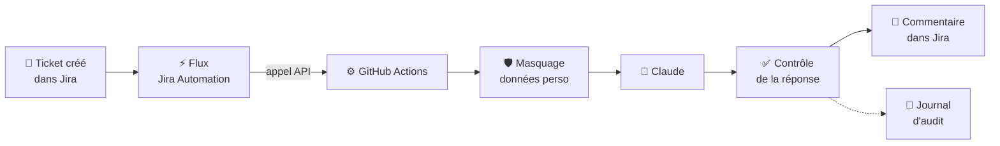

# 💡 Comprendre le POC en 5 minutes

> [!NOTE]
> **Pour qui ?** Un collègue qui a vu le POC et veut comprendre ce qu'il fait, pourquoi il est construit ainsi et comment le réutiliser chez un client.
> **Mis à jour le** 16/11/2026 : briques 1 (triage IA), 2 (livraison tracée) et 3 (revue de PR) validées en conditions réelles ; brique 4 (post-mortem) construite, en cours de validation.

---

## 1. En une phrase

Le POC montre comment **l'IA peut s'intégrer entre Jira, Confluence et les outils DevOps** d'un client pour supprimer les tâches répétitives (trier les tickets, écrire les release notes, rédiger les post-mortems), **sans jamais décider à la place de l'équipe**.

## 2. Le problème qu'on résout

Les équipes IT des grands comptes perdent du temps sur les mêmes irritants :

| Irritant | Conséquence | Brique qui y répond |
|---|---|---|
| Tickets flous, incomplets, en doublon | Allers-retours, tri manuel, bugs traités deux fois | 🧠 **1. Triage IA** ✅ |
| Statuts Jira décorrélés du code et des déploiements | Personne ne sait ce qui est réellement livré | 🚀 **2. Jira + CI/CD** ✅ |
| Release notes écrites à la main, en retard | Documentation fausse ou absente | 🚀 **2. Jira + CI/CD** ✅ |
| Code qui ne fait pas ce que le ticket demandait | Oublis découverts en recette | 🔍 **3. Revue IA des PR** ✅ |
| Post-mortems écrits des jours après, ou jamais | On refait les mêmes erreurs | 📚 **4. Incident vers post-mortem** 🔄 |

## 3. Ce qui fonctionne aujourd'hui

### 🧠 Brique 1 : le triage IA des tickets

**Ce que voit l'utilisateur :** il crée un ticket dans Jira, même mal rédigé. Environ **30 secondes** plus tard, un commentaire apparaît dans le ticket :

```
🤖 Proposition de triage IA, à valider par l'équipe.   Qualité estimée : 2/5

Reformulation   Erreur à la validation du panier pour le paiement
Priorité        🟠 Haute (et ce qui permettrait de la passer en Critique)
Composant       Paiement
Doublons        PI-2 (confiance forte) : même signalement
                PI-1 (confiance moyenne) : même étape, symptôme compatible
Questions       5 questions précises à poser à l'auteur
```

**Ce que ça change :** un ticket inexploitable devient exploitable en 30 secondes. Le chef de projet valide au lieu de rédiger.

> [!IMPORTANT]
> L'IA **ne modifie aucun champ** du ticket. Elle propose dans un commentaire, l'équipe décide. Seul un label technique `ia-triage` est ajouté pour ne pas trier deux fois.

### 🚀 Brique 2 : la livraison tracée

**Ce que voit l'équipe :**
- un développeur nomme sa branche `PI-1-...` : le ticket passe **En cours** et affiche la branche, puis la PR ;
- la PR est fusionnée : le ticket passe **Terminé** ;
- on publie une version `v1.1.0` : le déploiement apparaît dans le ticket, une **page de notes de version** rédigée par l'IA est publiée (Confluence, ou la GitHub Release à défaut), la **version Jira** est créée et chaque ticket livré reçoit un commentaire "Livré dans v1.1.0".

**Ce que ça change :** plus de statuts oubliés, plus de release notes écrites à la main en fin de mois.

**Validé le 16/11 :** deux PR (une correction pour PI-1, une nouveauté pour PI-4), puis la release `v1.1.0`. Les tickets ont changé de statut seuls, et en moins de 2 minutes après la publication de la release, la page Confluence était publiée, la version Jira créée et les deux tickets commentés "Livré".

> [!NOTE]
> Les statuts et l'affichage des branches, PR et déploiements sont **100 % natifs** (application GitHub for Jira + flux Automation). Le code ne fait que ce que le natif ne sait pas faire : rédiger les notes et tenir les versions Jira à jour.

### 🔍 Brique 3 : la revue de PR contre le ticket

**Ce que voit le développeur :** environ une minute après l'ouverture de sa PR, un commentaire liste chaque critère d'acceptation du ticket avec un statut (✅ couvert, 🟠 partiel, ❌ absent, ❔ non vérifiable) et la preuve dans le code. À chaque push, le **même** commentaire est mis à jour.

**Ce que voit le chef de projet :** un commentaire dans le ticket Jira quand le verdict change ("Points à compléter : version anglaise du message").

**Ce que ça change :** l'oubli fonctionnel est repéré avant la revue humaine, pas en recette une semaine plus tard.

**Validé le 16/11 (PR #15, PI-3) :** l'oubli de la version anglaise a été détecté au premier push, puis reconnu comme corrigé. L'IA a aussi signalé, à juste titre, que la partie front du ticket n'était pas dans la PR. Le verdict (conforme, partiel, non conforme) est calculé par le code à partir de son analyse.

> [!NOTE]
> La revue IA ne juge ni le style ni l'architecture et **ne bloque pas** la fusion : elle complète la revue humaine sur la seule question "le code fait-il ce que demande le ticket ?".

### 📚 Brique 4 : de l'alerte au post-mortem (en cours de validation)

**Ce que voit l'astreinte :** une alerte de supervision crée un incident dans Jira, avec le service touché, la gravité, la procédure et le **dernier déploiement** (souvent la première piste). L'équipe commente ses actions dans l'incident.

**Ce que voit l'équipe le lendemain :** dès que l'incident passe "Terminé", un **brouillon de post-mortem** apparaît dans Confluence : résumé, durée, chronologie, cause probable avec un niveau de confiance, actions correctives proposées et questions à trancher en revue.

**Ce que ça change :** on passe d'une page blanche (ou d'un post-mortem jamais écrit) à 10 minutes de relecture.

> [!NOTE]
> Le post-mortem est **"blameless"** (aucune personne n'est mise en cause) et reste un **brouillon** : l'IA ne crée aucun ticket d'action, l'équipe décide. Sur notre sandbox, Jira Service Management n'est pas activé : les incidents vivent dans un projet Jira dédié (`PIOPS`), et basculer vers JSM ne demande que deux réglages.

## 4. Comment ça marche



1. **Jira Automation** (natif, inclus dans toutes les licences Jira Cloud) détecte la création du ticket et prévient GitHub.
2. **GitHub Actions** lance un script Python qui lit le ticket et les tickets ouverts, avec un extrait de leur description (pour repérer les doublons).
3. Les **données personnelles sont masquées** (e-mails, téléphones, IP, IBAN, clés d'API) avant tout envoi.
4. **Claude** analyse et répond dans un format imposé.
5. La réponse est **contrôlée** : format, valeurs autorisées, absence d'anomalie. Si elle est mauvaise, on relance une fois ; sinon on n'écrit rien.
6. Le commentaire est publié. Chaque appel est tracé dans un **journal d'audit**.

## 5. Les trois principes à retenir

| Principe | Concrètement |
|---|---|
| 🧑‍⚖️ **L'IA propose, l'humain décide** | Commentaires et suggestions, jamais de modification silencieuse des champs |
| 🛡️ **Sécurité et traçabilité dès le départ** | Masquage avant envoi, journal d'audit sans contenu sensible, secrets hors du code |
| 🔌 **Indépendance vis-à-vis des outils** | L'IA est isolée dans un module : changer de fournisseur d'IA, de CI ou de cloud ne remet pas en cause le reste |

## 6. Les questions qu'on me pose

<details>
<summary><b>Pourquoi ne pas utiliser Rovo, l'IA d'Atlassian ?</b></summary>

Rovo couvre très bien les usages standard. Le POC le complète quand le client a besoin de :
- **choisir son modèle et son hébergement** (Anthropic, AWS Bedrock, Google Vertex, Azure) ;
- **versionner et relire ses règles** (prompts dans Git, modifiés par PR) ;
- **relier Jira à sa chaîne CI/CD** et à sa supervision (briques 2 à 4) ;
- **un journal d'audit détaillé** par appel.

À noter : utiliser un agent Rovo nécessite qu'un administrateur de l'organisation l'active. Le modèle de triage Rovo proposé par Atlassian se limite par défaut à suggérer des améliorations de la description.
</details>

<details>
<summary><b>Quelles données partent vers l'IA ?</b></summary>

Le titre et la description du ticket, plus la liste des titres des tickets ouverts. **Avant l'envoi**, les e-mails, téléphones, adresses IP, IBAN, numéros de carte et clés d'API sont remplacés par des balises (`[EMAIL]`, `[IP]`...). Limite connue : les noms de personnes ne sont pas masqués (il faudrait un outil spécialisé, prévu dans l'architecture).
</details>

<details>
<summary><b>Et si l'IA se trompe ?</b></summary>

Trois garde-fous :
1. Elle ne fait que **proposer** : rien n'est appliqué sans validation.
2. Sa réponse est **contrôlée par le code** : un composant ou un label qui n'existe pas dans le référentiel du projet est retiré.
3. Une réponse mal formée est **relancée une fois**, puis abandonnée : mieux vaut pas de commentaire qu'un commentaire faux.
</details>

<details>
<summary><b>Combien ça coûte ?</b></summary>

Quelques fractions de centime par ticket avec le modèle utilisé (Claude Haiku, le plus économique). Pour le POC, 5 $ de crédit suffisent largement. Les tokens consommés sont tracés à chaque appel dans le journal d'audit, ce qui permet de suivre le coût réel.
</details>

<details>
<summary><b>Le client est sous GitLab / Azure DevOps / Jenkins, ça marche ?</b></summary>

Oui. Le code Python ne dépend pas de GitHub ; seul le fichier qui déclenche le traitement change. Le détail est dans [l'architecture](architecture.md#adapter-le-poc-à-un-autre-client).
</details>

<details>
<summary><b>Pourquoi 30 secondes et pas instantané ?</b></summary>

GitHub Actions démarre une machine à chaque exécution (environ 20 secondes). C'est gratuit et parfait pour une démo. En production, le même code tourne dans une fonction serverless (AWS Lambda, Azure Functions...) et répond en quelques secondes.
</details>

<details>
<summary><b>Pourquoi les commentaires sont-ils signés "Mehdi BAHNIS" ?</b></summary>

Le POC utilise mon compte Atlassian. Chez un client, on crée un compte de service nommé (par exemple "Assistant IA").
</details>

<details>
<summary><b>Pourquoi les notes de version ne sont-elles pas forcément dans Confluence ?</b></summary>

Elles le sont dès que Confluence est configuré. Sinon, elles sont publiées dans la GitHub Release : c'est la preuve que la brique ne dépend pas de l'outil de documentation du client (Confluence, wiki GitLab, SharePoint...).
</details>

<details>
<summary><b>Comment l'IA sait-elle quels tickets sont livrés ?</b></summary>

Grâce à la clé du ticket (`PI-1`) dans le nom de branche ou le titre de la PR, la même convention que celle utilisée par GitHub for Jira. Le script liste les PR fusionnées depuis la version précédente et lit les tickets cités. L'IA ne peut citer que ces tickets et PR : toute référence inventée est retirée par le code.
</details>

<details>
<summary><b>Pourquoi la revue de PR ne commente-t-elle pas le style ou les bugs ?</b></summary>

Parce que d'autres outils le font déjà, et que c'est le rôle de la revue humaine. Notre angle est celui qu'aucun outil ne couvre sans Jira : relier le code au besoin métier. Une revue courte et ciblée est aussi beaucoup plus lue qu'une liste de 30 remarques.
</details>

<details>
<summary><b>Le post-mortem ne risque-t-il pas de désigner un coupable ?</b></summary>

Non, c'est une règle de conception : l'IA décrit des rôles ("l'astreinte", "l'équipe de développement"), jamais des personnes, et le code retire les noms des auteurs Jira s'il en reste. La cause est présentée comme une hypothèse avec un niveau de confiance, à confirmer en revue.
</details>

<details>
<summary><b>Combien de temps pour l'installer chez un client ?</b></summary>

Pour la brique 1 sur un projet : une demi-journée (créer les accès, adapter le référentiel de composants et labels, brancher le flux), puis quelques jours d'observation pour ajuster le prompt à leurs tickets.
</details>

## 7. Comment on l'a construit

| Étape | Ce qu'on a fait | Pourquoi |
|---|---|---|
| **0. Socle** | Module IA commun, masquage, journal d'audit, tests automatiques, tickets de démo fictifs | Poser la sécurité et la qualité une fois pour toutes, avant les fonctionnalités |
| **1. Triage** | Prompt de triage, script, workflow GitHub, commentaire mis en forme | La brique la plus visible et la plus simple à démontrer |
| **1 bis. Fiabilisation** | Format de réponse imposé par l'API, contrôle et relance, règles métier dans le code | Les premiers essais réels ont révélé des réponses mal formées |
| **1 ter. Automatisation** | Flux Jira Automation qui déclenche le triage à la création | Zéro action manuelle : c'est ce qui fait l'effet en démo |
| **1 quater. Doublons** | Les tickets candidats sont envoyés avec un extrait de leur description | L'IA ne voyait que les titres et ne pouvait pas confirmer un doublon évident |
| **2. Livraison** | Statuts en natif, workflow de release, notes de version IA, versions Jira | Montrer le lien entre le code, le déploiement et la documentation sans ressaisie |
| **4. Post-mortem** | Alerte vers incident (avec dernier déploiement), brouillon de post-mortem IA dans Confluence à la clôture | Ne plus partir d'une page blanche après un incident |
| **3. Revue de PR** | Évaluation de chaque critère d'acceptation face au diff, commentaire unique mis à jour, Jira informé si le verdict change | Repérer les oublis fonctionnels avant la recette |

Chaque choix important est expliqué dans une [fiche de décision](decisions/README.md).

## 8. Où trouver quoi

| Je veux... | Aller voir |
|---|---|
| Préparer et faire la démo | [Guide de démo](02-guide-de-demo.md) |
| Installer le POC sur un autre environnement | [Mise en place](guides/mise-en-place.md), puis [brique 1](guides/brique-1-triage.md), [brique 2](guides/brique-2-release.md) , [brique 3](guides/brique-3-revue-pr.md) et [brique 4](guides/brique-4-incident-postmortem.md) |
| Comprendre l'architecture et l'adapter à un client | [Architecture](architecture.md) |
| Savoir pourquoi un choix a été fait | [Décisions](decisions/README.md) |
| Modifier le comportement du triage | `ai_core/prompts/triage.md` et `config/triage.yaml` |
