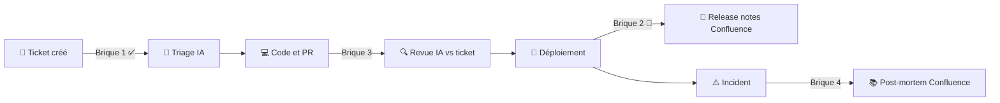

# 📓 Carnet de bord du POC

> [!NOTE]
> **Pour qui ?** Moi. Ce document me permet de tout retrouver : ce qu'on a fait, dans quel ordre, pourquoi, ce qui a cassé et ce que ça nous a appris.
> **Comment le lire ?** La partie 1 donne la vue d'ensemble. La partie 2 raconte le projet dans l'ordre. Les parties suivantes sont des références (glossaire, fichiers, accès, dépannage, questions pièges).
> **Dernière mise à jour :** 16/11/2026 (brique 2 construite, en cours de validation).

## Sommaire

1. [La vue d'ensemble](#1-la-vue-densemble)
2. [Le journal, étape par étape](#2-le-journal-étape-par-étape)
3. [Glossaire](#3-glossaire)
4. [Le code, fichier par fichier](#4-le-code-fichier-par-fichier)
5. [Accès, secrets et où ils sont rangés](#5-accès-secrets-et-où-ils-sont-rangés)
6. [Les tickets de la sandbox](#6-les-tickets-de-la-sandbox)
7. [Dépannage](#7-dépannage)
8. [Questions pièges et réponses](#8-questions-pièges-et-réponses)
9. [Ce que j'ai appris](#9-ce-que-jai-appris)
10. [Prochaines étapes](#10-prochaines-étapes)

---

## 1. La vue d'ensemble

### La mission

CBTW vend et intègre les produits Atlassian chez des grands comptes. On m'a demandé de montrer **à quel point l'IA, placée entre les outils DevOps et Jira/Confluence, peut être utile**. Le POC doit :
- se démontrer en quelques minutes ;
- être **adaptable** à d'autres outils DevOps et d'autres clouds ;
- être **documenté** pour que mes collègues puissent le présenter et le vendre.

### Le fil rouge

Plutôt que quatre démos isolées, on suit **la vie d'un ticket**, de sa création jusqu'à l'incident en production :

### L'architecture en une image

Pense à **trois étages** :

| Étage | Rôle | Analogie |
|---|---|---|
| **Déclencheurs** (Jira Automation, GitHub Actions) | Détecter un événement et lancer le traitement | La sonnette |
| **Module IA** (`ai_core`) | Préparer la demande, protéger les données, appeler l'IA, contrôler la réponse, tout tracer | Le standardiste sécurisé |
| **Adaptateurs** (`integrations`) | Lire et écrire dans Jira, Confluence, GitHub | Les bras |

**L'idée clé :** si un client change d'outil (GitLab au lieu de GitHub, Bedrock au lieu d'Anthropic), on ne change **qu'un étage**.

### Les trois principes que je défends

1. **L'IA propose, l'humain décide.** Toujours en commentaire, jamais de modification silencieuse.
2. **Sécurité et traçabilité dès le début.** Masquage avant envoi, journal d'audit, secrets hors du code.
3. **Indépendance.** Aucun outil n'est indispensable, chaque brique est indépendante.

---

## 2. Le journal, étape par étape

### 📅 12/11/2026 : cadrage

**Point de départ :** mon README V1 avec les 4 briques et les points d'attention grands comptes.

**Ce qu'on a décidé de changer, et pourquoi :**

| Changement | Pourquoi |
|---|---|
| Utiliser le **natif Atlassian** avant de coder (GitHub for Jira, Jira Automation) | Un client qui connaît Jira dirait "on a déjà ça". Et on vend de l'Atlassian : il faut montrer qu'on en tire le maximum. ([décision 0002](decisions/0002-natif-atlassian-avant-code.md)) |
| Préparer la réponse à **"pourquoi pas Rovo ?"** | Première question d'un client Atlassian |
| Isoler l'IA dans un **module commun** | C'est la preuve concrète de "l'adaptabilité" demandée ([décision 0001](decisions/0001-module-ia-commun.md)) |
| ScriptRunner **en option seulement** | App payante que tous les clients n'ont pas |
| Ajouter un **script de remise à zéro** de la démo | Sans lui, la démo n'est pas rejouable par un collègue ([décision 0006](decisions/0006-donnees-demo-reinitialisables.md)) |
| Documenter **chaque décision** dans une fiche | Pouvoir répondre "pourquoi ?" en rendez-vous |

**Estimation donnée :** 6 à 8 jours de travail effectif côté Claude, 5 à 6 heures de mon côté, 2 à 3 semaines calendaires.

### 📅 12/11/2026 : itération 0, le socle

**Objectif :** poser les fondations sécurisées **avant** la première fonctionnalité.

**Ce qui a été construit :**
- **`ai_core`**, le module IA commun. Tout appel à l'IA passe par `ask()`, qui fait toujours dans le même ordre : charger le prompt versionné, masquer les données, appeler le fournisseur, contrôler la réponse, écrire le journal d'audit.
- **Le masquage** : e-mails, téléphones, IP, IBAN, cartes bancaires et clés d'API sont remplacés par `[EMAIL]`, `[IP]`... ([décision 0003](decisions/0003-masquage-et-audit.md))
- **Le journal d'audit** : une ligne JSON par appel (modèle, version du prompt, tokens, ce qui a été masqué). **Jamais le contenu**, seulement une empreinte.
- **Un faux fournisseur d'IA** (`fake`) : pour tester sans payer et sans réseau.
- **Deux workflows GitHub** : la CI (tests à chaque push, gratuite) et un smoke test manuel qui appelle vraiment Claude.
- **8 tickets fictifs** (boutique imaginaire "Maison Lumen"), créés dans Jira : PI-1 à PI-8. Chacun a un rôle dans la démo.
- **6 fiches de décision**, l'architecture et le guide de mise en place.

**Incidents de parcours :**

| Incident | Ce qu'on a fait | Leçon |
|---|---|---|
| La clé API Anthropic a été envoyée dans le chat | Clé révoquée, nouvelle clé rangée directement dans les Secrets GitHub | Une clé qui passe dans un chat, un ticket ou un e-mail est compromise. Elle va **directement** dans le coffre (Secrets GitHub) |
| Les types de tickets Jira sont en français ("Tâche" et non "Task") | Le script de remise à zéro traduit automatiquement | Chez un client, l'instance peut être dans n'importe quelle langue |
| Mon compte GitHub n'était pas relié à Claude | Livraison par zip, puis installation de l'app GitHub "Claude" sur le dépôt | Désormais, Claude pousse les branches et ouvre les PR ; je relis et je fusionne |

**Résultat :** smoke test **vert**. Claude a bien répondu, et il n'a reçu que `[EMAIL]` et `[IP]` à la place des vraies données.

### 📅 12/11/2026 : brique 1, le triage IA

**Objectif :** à la création d'un ticket, publier une proposition de triage en commentaire.

**Comment ça marche :**
1. `scripts/triage_ticket.py` lit le ticket et les tickets ouverts du projet (pour les doublons).
2. Il appelle `ask("triage", ...)` avec le prompt `ai_core/prompts/triage.md`.
3. Il publie un commentaire mis en forme (encadré bleu, titres, listes) au format ADF (le format de texte riche de Jira).
4. Il ajoute le label `ia-triage` pour ne pas trier deux fois.

**Les choix importants :**
- **Commentaire, pas modification des champs** ([décision 0007](decisions/0007-triage-propose-ne-modifie-pas.md)). Une erreur de l'IA ne casse rien.
- **Référentiel imposé** (`config/triage.yaml`) : l'IA ne peut proposer que des composants et labels qui existent. C'est le fichier à adapter chez chaque client.

### 📅 12 au 16/11/2026 : fiabiliser le triage (les 7 versions du prompt)

C'est la partie la plus instructive du projet. Chaque essai réel a révélé un problème.

| Version | Problème constaté | Correction | Ce que ça m'apprend |
|---|---|---|---|
| **v1** | Le run plante : `JSONDecodeError`. Claude avait écrit `"Payer"` avec des guillemets dans une phrase, ce qui cassait le JSON | On impose le format via l'API (tool use) au lieu de le demander dans le texte ([décision 0008](decisions/0008-sorties-structurees.md)) | Une consigne écrite finit toujours par être enfreinte. Ce qui compte doit être **garanti par le système** |
| **v2** | Priorité "Critique" à cause du "urgent !!" de l'auteur ; 7 questions dont une sur `[EMAIL]` | Règles de priorité fondées sur l'impact ; 5 questions maximum ; pas de question sur les données masquées | L'IA reprend le ton de l'utilisateur si on ne lui dit pas de s'en méfier |
| **v3** | Doublon PI-1 en confiance "faible" | Définition précise de chaque niveau de confiance | Des mots comme "faible" ou "moyenne" doivent être **définis**, sinon chacun les interprète |
| *(démo)* | PI-1 restait "faible", et l'IA avait raison : PI-2 ne contenait aucun indice | **On a modifié les données de démo**, pas le prompt : PI-2 mentionne maintenant "ça plante quand ils valident le panier" | Ne jamais pousser l'IA à surinterpréter pour réussir une démo : chez le client, elle inventerait des doublons |
| **v4** | Faux critères d'acceptation ("le ticket doit être complété") | Liste vide si le ticket est trop flou | |
| *(workflow)* | Un ticket déjà trié affichait un run **vert** sans rien faire | Avertissement jaune et résumé "Triage ignoré" sur la page du run | Un succès silencieux est un piège : ce qui n'a rien fait doit le dire |
| **v5** | **Balisage parasite** dans la justification (`</justification_priorite><parameter name="composant">...`) et composant perdu ; label "regression" injustifié | Mode strict + contrôle de chaque réponse + une relance + règles métier dans le code ; labels seulement si justifiés | On contrôle la sortie d'une IA comme n'importe quelle donnée entrante |
| **v6** | Le défaut revient sur PI-11 malgré le mode strict. Le contrôle le bloque (rien de faux publié) mais le triage échoue | Abandon du tool use au profit du **format de réponse structuré natif** de l'API ; `composant` sans valeur nulle | Le mode "outil" fait écrire au modèle une syntaxe interne qui peut fuir dans les textes. Il faut utiliser l'outil prévu pour le besoin |
| *(v6 bis)* | Réponse **tronquée** : elle dépassait la limite de 1 500 tokens | Limite réglable par prompt (4 000 pour le triage) ; l'erreur affiche désormais la fin de la réponse coupée | Une limite trop basse ne se voit qu'en conditions réelles. Le message d'erreur doit aider à diagnostiquer |
| **v7** | PI-2 et PI-10, **identiques** à PI-11, classés en confiance "moyenne" : l'IA ne recevait que les **titres** des autres tickets | Envoi d'un extrait de 200 caractères de la description de chaque candidat ; "forte" couvre deux tickets identiques même peu détaillés | Avant d'accuser le modèle, vérifier ce qu'on lui donne réellement à lire |

> [!TIP]
> **Comment raconter ça en rendez-vous :** "Pendant la construction, l'IA nous a renvoyé une réponse corrompue. Nos garde-fous l'ont bloquée avant qu'elle n'arrive dans Jira, et le journal d'audit nous a permis de trouver la cause en quelques minutes. C'est exactement ce qui se passera chez vous : l'IA n'est pas infaillible, le système autour l'est davantage."

### 📅 16/11/2026 : déclenchement automatique

**Ce qu'on a fait :**
1. **Un token GitHub "fine-grained"** limité au dépôt et au seul droit *Contents: Read and write*. C'est le droit qu'exige l'API GitHub pour recevoir un signal "déclenche le workflow".
2. **Un flux Jira Automation** `IA - Triage à la création` :
   - déclencheur : ticket créé ;
   - condition : le ticket ne porte pas le label `poc-demo` (les tickets du jeu de démo se trient à la main) ;
   - action : "Envoyer une requête web" vers `https://api.github.com/repos/mbahnis/POC-AI-Atlassian/dispatches`.

**Résultat :** ticket PI-9 créé, commentaire publié **en environ 30 secondes**, sans intervention.

**Répétition de la démo (PI-11, 16/11, prompt v7) :** le ticket créé "en direct" (identique à PI-2) obtient une priorité Haute justifiée, le composant Paiement, **PI-2 et PI-10 en doublon fort**, PI-1 en doublon moyen, PI-8 écarté, 5 questions utiles. C'est le résultat de référence pour le guide de démo.

**Constats :**
- Atlassian appelle désormais les règles d'automatisation des **"flux"** (bouton "Créer un flux").
- **La priorité par défaut du projet est "Critique"** : chaque ticket arrive en Critique. À passer en "Moyenne" pour la démo.
- Les commentaires sont signés **"Mehdi BAHNIS"**, car le token Jira est le mien. Chez un client : compte de service.

### 📅 16/11/2026 : comparaison avec Rovo

**Ce qu'on voulait faire :** lancer le modèle Atlassian "Utiliser l'agent Rovo pour trier les bugs dans Jira" sur PI-10 (copie exacte de PI-2) et comparer.

**Ce qu'on a constaté :**
- Le modèle est un flux en 4 étapes : déclenchement manuel, condition "type = Bug", action "Utiliser l'agent" avec la consigne *"Analyse the description of {{issue.url}}. How could it improve?"*, puis "Ajouter un commentaire" avec la réponse brute.
- **Rovo n'est pas activé** sur la sandbox : *"Pour utiliser un agent Rovo, votre administrateur d'une organisation doit activer Rovo AI."*

**Comparaison à ce stade :**

| | Modèle Rovo (par défaut) | Notre triage |
|---|---|---|
| Ce qu'il produit | Suggestions pour améliorer la description | Qualité, reformulation, priorité justifiée, composant, labels, doublons, critères, questions |
| Référentiel du projet | Non utilisé | Imposé (`config/triage.yaml`) et contrôlé par le code |
| Détection de doublons | Non prévue dans la consigne | Oui, avec niveau de confiance défini |
| Masquage des données | Géré par Atlassian, non visible | Explicite, testé, tracé |
| Format de sortie | Texte libre de l'agent | Structuré, contrôlé, relancé si corrompu |
| Prérequis | **Activation de Rovo par un admin de l'organisation** | Une clé API et un flux Automation |
| Qualité réelle de la réponse | **À vérifier** (Rovo non activé) | Validée sur PI-2, PI-9 |

> [!WARNING]
> Ne pas présenter cette comparaison comme un "match gagné". La qualité réelle de Rovo n'a pas été testée. Le bon discours : "Rovo pour le standard, notre approche quand vous voulez maîtriser les règles, les données et le lien avec la CI/CD."

### 📅 16/11/2026 : brique 2, la livraison tracée

**Objectif :** relier le code, le déploiement et la documentation sans ressaisie.

**Le découpage, et pourquoi :**

| Partie | Qui la fait | Pourquoi |
|---|---|---|
| Afficher branches, PR et déploiements dans Jira | **Natif** : application GitHub for Jira | Ça existe, c'est maintenu par Atlassian, c'est inclus |
| Statut En cours / Terminé | **Natif** : 2 flux Automation (branche créée, PR fusionnée) | Pas une ligne de code |
| Déploiement | GitHub Actions, job `deploy` dans l'environnement `production` | Simulé pour le POC ; l'environnement nommé fait remonter le déploiement dans Jira |
| Notes de version | **Ce POC** : `scripts/release_notes.py` + prompt `release_notes` (Sonnet) | Le natif ne sait pas rédiger |
| Version Jira (`fixVersion`) et commentaire "Livré" | **Ce POC** | Le natif ne relie pas une release GitHub à une version Jira |

**Comment le script retrouve ce qui est livré :**
1. Il prend le tag précédent (`v1.0.0`) et le nouveau (`v1.1.0`).
2. Il liste les commits entre les deux et en déduit les PR fusionnées (messages "Merge pull request #12" ou "Titre (#12)").
3. Dans chaque PR, il cherche les clés de tickets (`PI-1`) dans la branche, le titre et la description.
4. Il lit ces tickets dans Jira, envoie le tout à l'IA (données masquées), puis **retire toute référence que l'IA citerait sans qu'elle existe**.

**Choix notables :**
- **Publication interchangeable** : Confluence si `CONFLUENCE_SPACE_KEY` est défini, sinon GitHub Release ([décision 0009](decisions/0009-release-notes-publication-interchangeable.md)).
- **Premier tag = référence** : `v1.0.0` ne produit pas de notes, sinon l'IA résumerait tout l'historique du POC.
- **Appli fictive** `app/paiement.py` : elle ne sert qu'à avoir du vrai code à modifier dans les PR de démo. Volontairement, ses messages d'erreur sont **uniquement en français** : c'est l'oubli que la brique 3 détectera face au ticket PI-3.

**Blocage rencontré :** Confluence répond en **404** sur la sandbox (via le connecteur), comme s'il n'était pas activé. D'où la publication alternative, qui permet d'avancer.

**État :** code et tests prêts (42 tests). Reste à faire de mon côté : installer GitHub for Jira, créer les 2 flux de statut, vérifier Confluence, puis répéter le scénario complet.

---

## 3. Glossaire

| Terme | En clair | Exemple dans le POC |
|---|---|---|
| **Prompt** | La consigne donnée à l'IA | `ai_core/prompts/triage.md` |
| **Schéma JSON** | Le "formulaire" que l'IA doit remplir : quels champs, quels types, quelles valeurs autorisées | `triage.schema.json` |
| **Sortie structurée** (structured outputs) | Mode de l'API où l'IA est **obligée** de remplir le schéma, au lieu d'écrire du texte libre | Utilisé depuis la v6 |
| **Tool use** | Mécanisme où l'IA "appelle un outil" avec des paramètres. On l'avait détourné pour obtenir du JSON (v2 à v5) ; abandonné car il laissait fuir sa syntaxe interne | |
| **Token** (IA) | L'unité de texte facturée (environ 3/4 de mot) | Tracé dans le journal d'audit |
| **Token** (accès) | Un mot de passe technique pour une API | Token Jira, token GitHub |
| **Masquage** | Remplacer une donnée sensible par une balise avant l'envoi | `sophie@...` devient `[EMAIL]` |
| **Empreinte** (hash) | Un code calculé à partir d'un texte, qui permet de reconnaître le texte sans le stocker | `input_fingerprint` dans l'audit |
| **ADF** | Atlassian Document Format : le format JSON des textes riches dans Jira Cloud et Confluence | `integrations/adf.py` |
| **JQL** | Le langage de recherche de Jira | `project = PI AND statusCategory != Done` |
| **Workflow GitHub Actions** | Un enchaînement de commandes exécuté par GitHub sur une machine temporaire | `.github/workflows/triage.yml` |
| **workflow_dispatch** | Déclencher un workflow à la main (bouton "Run workflow") | Test du triage sur PI-2 |
| **repository_dispatch** | Déclencher un workflow depuis l'extérieur via l'API GitHub | Appelé par le flux Jira |
| **Secret / variable GitHub** | Valeur rangée dans les paramètres du dépôt. Un secret est chiffré et masqué dans les logs, une variable non | `ANTHROPIC_API_KEY` (secret), `JIRA_BASE_URL` (variable) |
| **Fine-grained token** | Token GitHub limité à certains dépôts et certains droits | Celui du flux Jira |
| **Flux** (Jira Automation) | Une règle d'automatisation : déclencheur, conditions, actions | `IA - Triage à la création` |
| **Rovo** | L'IA intégrée d'Atlassian (recherche, agents) | Comparaison en cours |
| **Tag** | Une étiquette posée sur un état du code, en général un numéro de version | `v1.1.0` déclenche la brique 2 |
| **GitHub Release** | La page d'une version sur GitHub, avec ses notes | Publication de secours des notes de version |
| **Environnement GitHub** | Un nom de cible de déploiement (`production`), sur lequel on peut mettre des règles (validation manuelle) | Job `deploy` de la brique 2 |
| **GitHub for Jira** | Application officielle Atlassian qui affiche branches, PR et déploiements GitHub dans les tickets | Partie native de la brique 2 |
| **fixVersion** | Le champ Jira "Version corrigée" : dans quelle version un ticket a été livré | Rempli par la brique 2 |
| **Format storage** | Le format XHTML des pages Confluence, avec des macros (`info`, `warning`...) | Page de notes de version |
| **MCP** | Protocole qui permet à un assistant IA d'agir dans un outil (ici, Claude dans Jira et Confluence) | Utilisé par Claude pour créer les tickets de démo |
| **Fiche de décision** (ADR) | Une page courte qui explique un choix d'architecture | `docs/decisions/` |
| **CI** | Intégration continue : les tests tournent automatiquement à chaque modification | `.github/workflows/ci.yml` |
| **Lint** | Vérification automatique du style et des erreurs simples du code | `ruff` |

---

## 4. Le code, fichier par fichier

### `ai_core/` : le module IA commun

| Fichier | Rôle | À retenir |
|---|---|---|
| `engine.py` | **Le chef d'orchestre.** `ask()` enchaîne : prompt, masquage, appel, contrôle (avec une relance), audit | Toutes les briques passent par là |
| `config.py` | Les réglages, lus dans les variables d'environnement | `AI_PROVIDER`, `AI_MODEL_FAST`, `AI_MASKING`... |
| `masking.py` | Les règles de masquage (expressions régulières) | Ne masque pas les noms de personnes (limite connue) |
| `audit.py` | L'écriture du journal d'audit | Jamais de contenu, seulement une empreinte |
| `prompts.py` | Lit un prompt `.md` (avec son en-tête : version, niveau de modèle, longueur max) et son schéma `.schema.json` | Une variable oubliée fait échouer l'appel (volontairement) |
| `validation.py` | Contrôle la réponse : schéma respecté, pas de balisage parasite. Adapte aussi le schéma au mode strict | Ajouté après le bug de la v5 |
| `providers/anthropic_provider.py` | L'appel réel à Claude | Utilise le format de réponse structuré natif (`output_config`) |
| `providers/fake_provider.py` | Le faux fournisseur pour les tests | Réponse prévisible, gratuite |
| `prompts/smoke_test.md` | Prompt du test de bon fonctionnement | |
| `prompts/release_notes.md` + `.schema.json` | Prompt des notes de version (modèle Sonnet) et format de sa réponse | |
| `prompts/triage.md` + `.schema.json` | Prompt du triage (v7) et format de sa réponse. L'en-tête fixe aussi `max_tokens: 4000` | |

### `integrations/` : les bras

| Fichier | Rôle |
|---|---|
| `jira_client.py` | Lire un ticket, chercher (JQL), créer, commenter, ajouter un label, supprimer. Conversion texte vers ADF et inversement |
| `adf.py` | Petits constructeurs pour des commentaires jolis (encadré, titres, listes, gras) |
| `github_client.py` | Retrouver les PR fusionnées entre deux tags, extraire les clés de tickets, créer ou mettre à jour une GitHub Release |
| `confluence_client.py` | Créer ou mettre à jour une page Confluence (API v2, format storage) |

### `scripts/` : ce qu'on exécute

| Script | Rôle | Commande |
|---|---|---|
| `smoke_test.py` | Vérifie la chaîne IA de bout en bout | `python -m scripts.smoke_test` |
| `release_notes.py` | Brique 2 : notes de version d'une release, publication Confluence ou GitHub, version Jira et commentaires | `python -m scripts.release_notes --tag v1.1.0 [--dry-run]` |
| `triage_ticket.py` | Brique 1 : triage d'un ticket. Envoie les candidats avec un extrait de description. Contient aussi `normalize()`, les règles métier appliquées par le code | `python -m scripts.triage_ticket PI-2 [--dry-run] [--force]` |
| `demo_reset.py` | Supprime les tickets `poc-demo` et recrée le jeu de démo | `python -m scripts.demo_reset [--apply]` |

### Autres fichiers

| Fichier | Rôle |
|---|---|
| `config/triage.yaml` | Référentiel du client : composants, labels, label posé après triage |
| `demo/seed_tickets.yaml` | Les 8 tickets de démo, avec le rôle de chacun |
| `.github/workflows/ci.yml` | Tests et lint à chaque push et PR |
| `.github/workflows/ai-smoke-test.yml` | Smoke test manuel |
| `.github/workflows/triage.yml` | Brique 1, déclenchée par Jira (`repository_dispatch`) ou à la main |
| `.github/workflows/release.yml` | Brique 2 : sur un tag `v*`, tests, déploiement simulé, puis notes de version |
| `app/paiement.py` | Application fictive pour les PR de démo (briques 2 et 3) |
| `tests/` | 42 tests automatiques, dont le cas réel du balisage parasite rejoué |

---

## 5. Accès, secrets et où ils sont rangés

| Accès | Où il est rangé | Qui l'a créé | Ce qu'il permet | À faire en fin de POC |
|---|---|---|---|---|
| Clé API Anthropic | Secret GitHub `ANTHROPIC_API_KEY` | Moi, sur console.anthropic.com (limite 5 $) | Appeler Claude | Révoquer |
| Token API Atlassian | Secret GitHub `JIRA_API_TOKEN` (+ `JIRA_EMAIL`) | Moi, sur id.atlassian.com | Lire et écrire dans Jira avec mes droits | Révoquer |
| URL Jira | Variable GitHub `JIRA_BASE_URL` | | `https://one-atlas-bfqf-sandbox.atlassian.net` | |
| Espace Confluence | Variables GitHub `CONFLUENCE_SPACE_KEY`, `CONFLUENCE_PARENT_TITLE` | | Où publier les notes (sinon GitHub Release) | |
| `GITHUB_TOKEN` | Fourni automatiquement par GitHub Actions | GitHub | Lire les PR, créer la Release (droit `contents: write` dans le workflow) | Rien à faire |
| Token GitHub fine-grained | En-tête du flux Jira Automation | Moi, sur GitHub | Déclencher un workflow sur ce dépôt uniquement | Révoquer |
| App GitHub "Claude" | Installée sur le dépôt | Moi | Claude pousse des branches et ouvre des PR | Désinstaller si besoin |
| Connecteur Atlassian (MCP) | claude.ai | Moi (OAuth) | Claude lit et écrit dans Jira/Confluence avec mes droits | Déconnecter si besoin |

> [!CAUTION]
> Le dépôt est **public**. Aucun secret ne doit y être écrit, même temporairement. Les secrets vont dans *Settings > Secrets and variables > Actions*.

---

## 6. Les tickets de la sandbox

| Clé | Résumé | Rôle |
|---|---|---|
| PI-1 | Erreur 500 au paiement par carte | Ticket bien rédigé, **doublon** à détecter |
| PI-2 | ça marche pas le paiement | **Ticket flou principal**, démo du triage |
| PI-3 | Message d'erreur FR/EN au refus de paiement | Story avec critères précis, pour la **brique 3** |
| PI-4 | Export CSV des commandes | Story bien rédigée : l'IA ne doit pas la réécrire |
| PI-5 | page produit lente | Ticket vague : l'IA doit lister les questions |
| PI-6 | bug login sur mobile | **Données personnelles** : démo du masquage |
| PI-7 | Librairie PDF des factures | Dette technique (rapport de sprint, plus tard) |
| PI-8 | Le panier se vide après une erreur | Sujet voisin : l'IA doit nuancer |
| PI-9 | appli lente sur telephone | Test du **déclenchement automatique** (16/11). **À supprimer avant une démo** |
| PI-10 | copie de PI-2 | Réservé à la **comparaison Rovo** |
| PI-11 | copie de PI-2, sans label de démo | Répétition du ticket créé en direct ; a révélé les bugs corrigés en v6 et v7. **À supprimer avant une démo** |

PI-1 à PI-8 portent le label `poc-demo` : ce sont ceux que `demo_reset` supprime et recrée.

---

## 7. Dépannage

| Symptôme | Cause probable | Solution |
|---|---|---|
| Run vert mais pas de commentaire | Ticket déjà trié (label `ia-triage`) | Relancer avec "Retrier" coché, ou retirer le label |
| `401` dans le log | Token Jira ou e-mail faux | Recréer le token, mettre à jour les secrets |
| `404` dans le log | Mauvaise URL Jira ou mauvaise clé de ticket | Vérifier la variable `JIRA_BASE_URL` |
| "Réponse IA invalide après 2 tentatives" | L'IA a renvoyé deux réponses corrompues | Relancer ; si ça persiste, regarder le détail dans les avertissements du run |
| Le flux Jira ne déclenche rien | Flux désactivé, label `poc-demo` présent, ou token GitHub expiré | Journal d'audit du flux dans Jira (code de retour de GitHub) |
| La CI ne démarre pas sur une PR | GitHub attend l'accord du propriétaire | Bouton "Approve and run workflows" sur la PR |
| Conflit sur le README dans VS Code | Branche créée sans avoir fait un pull de `main` | Toujours faire **Pull** sur `main` avant de créer une branche |
| "Merge already in progress" | La PR n'avait plus rien à fusionner | Rafraîchir ; si la PR est vide, la fermer |
| "Rovo... administrateur doit activer Rovo AI" | Rovo non activé sur l'organisation | Demande à l'admin Atlassian de CBTW |
| Erreur 404 sur Confluence | Confluence non activé sur le site | Vérifier `/wiki` ; sans Confluence, laisser `CONFLUENCE_SPACE_KEY` vide (publication GitHub Release) |
| "Aucune PR fusionnée" à la release | Commits poussés directement sans PR, ou mauvais tag de départ | Passer par des PR ; relancer avec `--base` |
| Pas de notes au premier tag | Comportement voulu : le premier tag sert de référence | Créer un second tag |

---

## 8. Questions pièges et réponses

<b>"Votre masquage par expressions régulières, c'est léger, non ?"</b>

Oui, et je l'assume. Il couvre les formats structurés (e-mail, téléphone, IP, IBAN, carte, clés). Il ne détecte pas les noms propres ni les adresses postales. L'architecture permet de brancher un outil spécialisé (Microsoft Presidio par exemple) sans rien changer d'autre. Pour un client sensible, c'est la première amélioration à faire.

<b>"Pourquoi Haiku et pas le meilleur modèle ?"</b>

Le triage est une tâche simple et très fréquente : Haiku est rapide et très économique. Le modèle se change par une variable (`AI_MODEL_FAST`) sans toucher au code. Pour les tâches de raisonnement (revue de PR, post-mortem), on utilisera Sonnet (`AI_MODEL_SMART`).

<b>"Si l'IA renvoie n'importe quoi, que se passe-t-il ?"</b>

Quatre barrières : le format est imposé par l'API ; la réponse est contrôlée (schéma, balisage parasite) ; une réponse mauvaise est relancée une fois puis abandonnée ; les règles métier sont appliquées par le code (composant ou label hors référentiel retiré). Et dans tous les cas, rien n'est appliqué au ticket : c'est une proposition.

<b>"Pourquoi GitHub Actions et pas une Lambda ?"</b>

Pour le POC : gratuit, rien à héberger, logs visibles en démo. En production : la même logique Python en Lambda (ou Azure Functions, Cloud Run), pour répondre en quelques secondes et utiliser le coffre-fort de secrets du client. ([décision 0004](decisions/0004-github-actions-moteur-execution.md))

<b>"Comment mesurez-vous la qualité du triage ?"</b>

Pas encore de mesure automatique. La méthode proposée : pendant 2 à 3 semaines chez le client, compter les propositions acceptées telles quelles, modifiées, ou rejetées. Le commentaire garde la trace de ce que l'IA a proposé, ce qui rend la comparaison possible.

<b>"Le prompt, c'est du code ? Qui le maintient ?"</b>

C'est un fichier texte en français, lisible par un chef de projet. Il est versionné dans Git et modifié par PR, donc relu. Sa version est écrite dans le journal d'audit à chaque appel : on sait quelle version a produit quelle proposition.

<b>"Ça respecte le RGPD ?"</b>

Je ne suis pas juriste, donc je ne m'engage pas sur la conformité. Ce que le POC apporte concrètement : minimisation (masquage avant envoi), traçabilité (journal d'audit), possibilité d'héberger le modèle dans la région du client via son cloud provider. La validation reste à faire avec le DPO du client.

---

## 9. Ce que j'ai appris

1. **Ce qui doit être garanti ne peut pas reposer sur une consigne.** Le format, les valeurs autorisées, les limites : le système les impose, l'IA les remplit.
2. **Un garde-fou qui se déclenche est une information.** Le bug du balisage a été trouvé grâce aux avertissements et au journal d'audit, pas par chance.
3. **On corrige les données de démo, pas l'honnêteté de l'IA.** Forcer l'IA à "voir" un doublon pour réussir la démo, c'est lui apprendre à en inventer chez le client.
4. **Un succès silencieux est un piège.** Tout ce qui ne fait rien doit le dire clairement.
5. **Le natif d'abord.** Jira Automation fait le déclenchement sans une ligne de code, et c'est un argument de vente.
6. **Les secrets ne transitent jamais par un chat.**
7. **Avant d'accuser le modèle, vérifier ce qu'on lui envoie.** Le problème des doublons venait du script, pas de l'IA.
8. **Toujours faire un pull avant de créer une branche.**

---

## 10. Prochaines étapes

- [ ] Passer la priorité par défaut du projet à **Moyenne**
- [ ] Demander l'activation de Rovo à l'admin Atlassian de CBTW (facultatif) pour compléter la comparaison sur PI-10
- [ ] **Brique 2** : installer GitHub for Jira, créer les 2 flux de statut, vérifier Confluence, poser `v1.0.0`, répéter le scénario complet
- [ ] Brique 4 : incident vers post-mortem (Jira Service Management est disponible sur la sandbox)
- [ ] Brique 3 : revue IA des PR contre le ticket
- [ ] Remplacer mon compte par un compte de service pour signer les commentaires (pour la version client)
