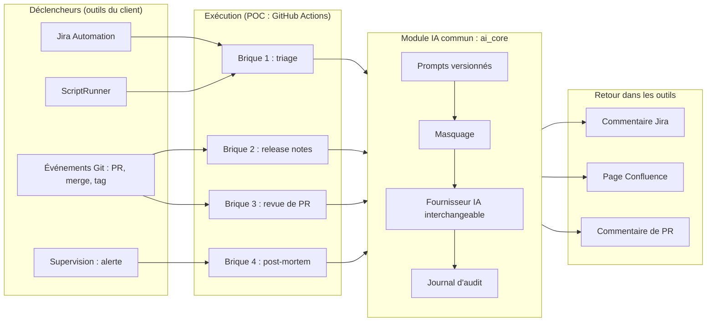

# 🏗️ Architecture

## Vue d'ensemble

## Les trois couches

| Couche | Rôle | Dossier | Ce qui change d'un client à l'autre |
|---|---|---|---|
| **Déclencheurs** | Détecter l'événement et lancer le traitement | `.github/workflows/`, règles Jira Automation, scripts ScriptRunner | Oui : GitLab CI, Azure DevOps, Jenkins, ServiceNow... |
| **Module IA** | Prompt, masquage, appel au modèle, audit | `ai_core/` | Non, seule la variable `AI_PROVIDER` change |
| **Adaptateurs** | Lire et écrire dans les outils (Jira, Confluence, GitHub) | `integrations/` | On ajoute un adaptateur par outil |

## Adapter le POC à un autre client

| Le client utilise... | Ce qu'on change |
|---|---|
| GitLab au lieu de GitHub | Les fichiers de workflow (`.gitlab-ci.yml`), un adaptateur `integrations/gitlab_client.py` |
| AWS Bedrock, Vertex AI ou Azure pour l'IA | Une classe dans `ai_core/providers/`, la variable `AI_PROVIDER` |
| Jira Data Center au lieu de Cloud | L'URL et l'authentification de `integrations/jira_client.py` (token personnel) |
| Pas de ScriptRunner | La variante Jira Automation (native, incluse dans toutes les licences Jira Cloud) |
| Datadog ou CloudWatch au lieu de Grafana | Seulement la configuration du webhook d'alerte (brique 4) |

## Circulation des secrets

Aucun secret dans le code. En CI, ils sont stockés dans les Secrets GitHub et injectés en variables d'environnement au moment de l'exécution :

| Secret | Usage |
|---|---|
| `ANTHROPIC_API_KEY` | Appels à Claude |
| `JIRA_EMAIL`, `JIRA_API_TOKEN` | Lecture et écriture dans Jira et Confluence |

En production, on utiliserait le coffre-fort du client (AWS Secrets Manager, Azure Key Vault, HashiCorp Vault) et un compte de service dédié plutôt qu'un compte personnel.
