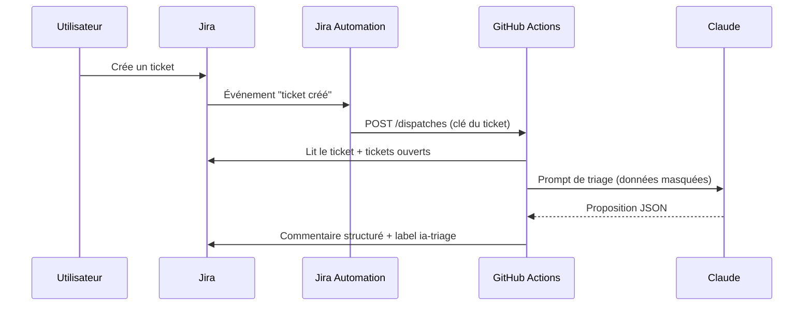

# 🧠 Brique 1 : triage IA des tickets

## Ce que ça fait

A la création d'un ticket, l'IA analyse le titre et la description, compare avec les tickets ouverts du projet, puis publie un **commentaire structuré** dans le ticket :

- qualité estimée du ticket (1 à 5)
- titre reformulé et résumé
- priorité, composant et labels proposés (uniquement parmi le référentiel du projet)
- doublons possibles, avec un niveau de confiance
- critères d'acceptation proposés
- questions à poser à l'auteur

L'IA **ne modifie aucun champ** : l'équipe lit la proposition et applique ce qu'elle retient ([décision 0007](../decisions/0007-triage-propose-ne-modifie-pas.md)). Un label `ia-triage` est ajouté pour ne pas trier deux fois le même ticket.

## Comment ça circule



Délai constaté : 20 à 40 secondes (démarrage du runner GitHub). En production, le même code déployé en fonction serverless répond en quelques secondes.

## Mise en place

### 1. Secrets Jira dans GitHub (si pas déjà fait)

Voir [mise en place](mise-en-place.md), sections 2 et 3 : `JIRA_EMAIL`, `JIRA_API_TOKEN` (secrets) et `JIRA_BASE_URL` (variable).

### 2. Tester à la main

**Actions > Brique 1 - Triage IA > Run workflow**, saisir `PI-2`, lancer. Le commentaire apparaît dans le ticket en moins d'une minute.

### 3. Token GitHub pour Jira Automation

Jira a besoin d'un droit limité pour déclencher le workflow.

1. GitHub > photo de profil > **Settings > Developer settings > Personal access tokens > Fine-grained tokens > Generate new token**.
2. Nom : `jira-automation-poc`. Expiration : 30 à 90 jours.
3. **Repository access** : *Only select repositories* > `POC-AI-Atlassian`.
4. **Permissions > Repository permissions > Contents** : *Read and write* (c'est le droit exigé par l'API `repository_dispatch`). Rien d'autre.
5. Générer et copier le token.

> En production, on remplace ce token personnel par une GitHub App ou un compte de service, avec rotation automatique.

### 4. Règle Jira Automation

Dans le projet : **Paramètres du projet > Automatisation > Créer une règle**.

| Étape | Réglage |
|---|---|
| Déclencheur | **Work item created** (ticket créé) |
| Condition | **Work item fields condition** : *Labels* ne contient pas `poc-demo` (les tickets du jeu de démo se trient à la main, pour garder la main pendant la démo) |
| Action | **Send web request** |

Réglages de l'action "Send web request" :

| Champ | Valeur |
|---|---|
| URL | `https://api.github.com/repos/mbahnis/POC-AI-Atlassian/dispatches` |
| Méthode | `POST` |
| En-tête `Accept` | `application/vnd.github+json` |
| En-tête `Authorization` | `Bearer <le token de l'étape 3>` (cocher l'option de masquage de la valeur si elle est proposée) |
| En-tête `X-GitHub-Api-Version` | `2022-11-28` |
| Corps | *Custom data* : voir ci-dessous |

```json
{
  "event_type": "jira-issue-created",
  "client_payload": { "issue_key": "{{issue.key}}" }
}
```

Nommer la règle `IA - Triage à la création`, l'activer. Pour vérifier : créer un ticket, puis regarder l'onglet **Actions** de GitHub et le **journal d'audit** de la règle dans Jira.

## Adapter à un client

| Situation | Adaptation |
|---|---|
| Autre projet ou référentiel | Modifier `config/triage.yaml` (composants, labels) |
| ScriptRunner disponible | Remplacer la règle Automation par un listener "Issue Created" qui fait le même appel HTTP |
| GitLab | Même règle Automation, URL du *pipeline trigger* GitLab au lieu de `/dispatches` |
| Ajuster le comportement de l'IA | Modifier `ai_core/prompts/triage.md` et incrémenter sa version |
