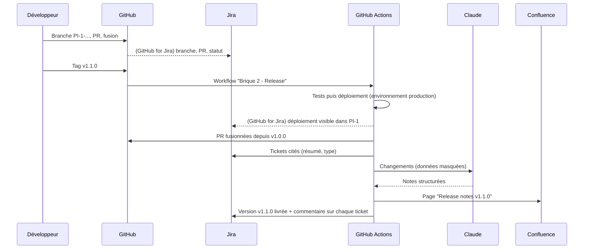

# 🚀 Brique 2 : Jira + CI/CD, livraison tracée et notes de version IA

## Ce que ça fait

| Moment | Ce qui se passe | Qui le fait |
|---|---|---|
| Un développeur crée une branche `PI-1-...` | Le ticket PI-1 affiche la branche et passe **En cours** | **Natif** : GitHub for Jira + flux Jira Automation |
| Il ouvre puis fusionne la PR | Le ticket affiche la PR, puis passe **Terminé** à la fusion | **Natif** |
| On pousse un tag `v1.1.0` | Déploiement (simulé) dans l'environnement `production` ; il apparaît dans les tickets | GitHub Actions + **natif** pour l'affichage |
| Juste après | L'IA rédige les **notes de version** depuis les PR et tickets, les publie dans **Confluence** (ou la GitHub Release), crée la **version Jira** `v1.1.0`, la rattache aux tickets et commente chaque ticket "Livré dans v1.1.0" | Ce POC |

> [!IMPORTANT]
> Le principe de la [décision 0002](../decisions/0002-natif-atlassian-avant-code.md) s'applique : tout ce qu'Atlassian fait en natif (statuts, affichage des branches, PR et déploiements) **n'est pas recodé**. Le code ne couvre que ce que le natif ne sait pas faire : rédiger les notes de version et tenir les versions Jira à jour.

## Comment ça circule

## Mise en place

### 1. GitHub for Jira (natif, 5 min, administrateur Jira)

1. Jira > ⚙️ > **Applications** > **Trouver de nouvelles applications** > chercher **"GitHub for Jira"** (éditeur : Atlassian) > **Obtenir l'application**.
2. Ouvrir l'application > **Connecter une organisation GitHub** > choisir le compte `mbahnis` > donner accès au dépôt `POC-AI-Atlassian`.
3. Vérifier : dans un ticket, le panneau **Développement** apparaît.

### 2. Flux de statut (natif, 5 min)

Dans le projet : **Paramètres de l'espace > Automatisation > Créer un flux**, deux flux :

| Flux | Déclencheur | Action |
|---|---|---|
| `Dev - Branche créée` | **Branche créée** | Transition du ticket vers **En cours** |
| `Dev - PR fusionnée` | **Pull request fusionnée** | Transition du ticket vers **Terminé** |

Ces déclencheurs n'apparaissent qu'une fois GitHub for Jira connecté. Le ticket concerné est trouvé grâce à la clé (`PI-1`) dans le nom de branche ou le titre de la PR.

### 3. Confluence (si disponible)

1. Créer un espace, par exemple **POC IA** (clé `POCIA`), et une page parente **Release notes**.
2. Dans GitHub > Settings > Secrets and variables > Actions > **Variables** :

| Nom | Valeur |
|---|---|
| `CONFLUENCE_SPACE_KEY` | `POCIA` |
| `CONFLUENCE_PARENT_TITLE` | `Release notes` |

Sans `CONFLUENCE_SPACE_KEY`, les notes sont publiées dans la **GitHub Release** du tag. Le token Jira existant sert aussi pour Confluence (même site Atlassian).

### 4. Environnement GitHub `production`

Il est créé automatiquement au premier déploiement. Chez un client, on y ajoute des **règles de protection** (validation manuelle obligatoire avant la mise en production).

## Rejouer la démo

1. Une première version de référence existe : `v1.0.0` (elle ne génère pas de notes, elle sert de point de départ).
2. Créer une branche `PI-1-erreur-500-paiement`, modifier `app/paiement.py`, ouvrir une PR dont le titre commence par `PI-1`, la fusionner.
3. Pousser le tag : sur GitHub, **Releases > Draft a new release > Choose a tag > `v1.1.0` > Create new tag > Publish release** (ou `git tag v1.1.0 && git push origin v1.1.0`).
4. Suivre **Actions > Brique 2 - Release**, puis ouvrir la page de notes et le ticket PI-1.

**Pour rejouer sans nouveau tag :** Actions > Brique 2 - Release > Run workflow > saisir le tag, avec "Générer sans rien publier" coché pour un essai à blanc.

## Adapter à un client

| Situation | Adaptation |
|---|---|
| GitLab, Azure DevOps, Bitbucket | Application d'intégration équivalente côté Atlassian (Bitbucket est natif) ; adaptateur `integrations/` pour lister les merge requests |
| Wiki autre que Confluence | Remplacer la publication (une fonction) ; la GitHub Release sert déjà d'exemple d'alternative |
| Vrai déploiement | Remplacer l'étape simulée par `terraform apply`, `helm upgrade`, `argocd sync`... ; garder l'environnement `production` pour la remontée dans Jira |
| Ton ou format des notes | Modifier `ai_core/prompts/release_notes.md` |
