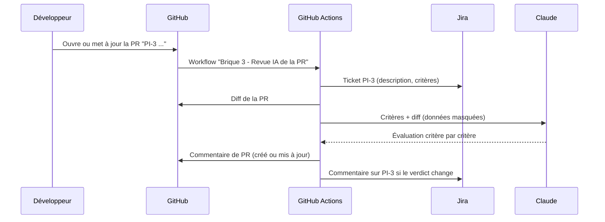

# 🔍 Brique 3 : revue IA d'une PR contre le ticket

## Ce que ça fait

À chaque ouverture ou mise à jour d'une pull request, l'IA répond à **une seule question** : *le code fait-il ce que le ticket demande ?*

1. Elle retrouve le ticket Jira cité dans la PR (clé dans la branche, le titre ou la description).
2. Elle lit ses **critères d'acceptation** et le **diff** de la PR.
3. Elle évalue chaque critère : ✅ couvert, 🟠 partiel, ❌ absent, ❔ non vérifiable depuis le code, avec la preuve (fichier et élément de code, ou ce qui manque).
4. Elle publie **un seul commentaire** dans la PR, mis à jour à chaque push (pas de spam), et commente le **ticket Jira** quand le verdict change.

> [!IMPORTANT]
> La revue IA **complète** la revue humaine, elle ne la remplace pas : elle ne juge ni le style, ni l'architecture, ni les performances. Elle **ne bloque pas** la fusion.

Si la PR ne cite aucun ticket, le commentaire le signale et invite à ajouter la clé : c'est aussi un rappel de bonne pratique.

## Comment ça circule

## Mise en place

Rien de plus que les briques précédentes : mêmes secrets (`ANTHROPIC_API_KEY`, `JIRA_EMAIL`, `JIRA_API_TOKEN`) et même variable (`JIRA_BASE_URL`). Le workflow `.github/workflows/pr-review.yml` se déclenche tout seul sur les PR.

**Choix de sécurité :** le workflow exécute le code de revue **tel qu'il est sur `main`**, pas celui de la PR. Une PR ne peut donc pas modifier le relecteur pour détourner les secrets.

## Rejouer la démo

Le ticket **PI-3** demande un message d'erreur clair quand le paiement est refusé, avec 4 critères dont **"en français et en anglais"**.

1. La branche `PI-3-message-erreur-paiement` ajoute `app/messages.py` : messages lisibles, code bancaire jamais affiché, action "Réessayer"... mais **uniquement en français** (l'oubli est volontaire).
2. On ouvre la PR : environ 1 minute plus tard, le commentaire de revue doit signaler le critère bilingue comme partiel ou absent, et PI-3 reçoit un commentaire "Points à compléter".
3. On pousse un correctif ajoutant l'anglais : le commentaire de la PR est **mis à jour** (pas dupliqué) et passe à ✅ ; PI-3 est commenté car le verdict a changé.

## Adapter à un client

| Situation | Adaptation |
|---|---|
| GitLab, Azure DevOps, Bitbucket | Adaptateur pour lire le diff et commenter la merge request ; le prompt et la logique ne changent pas |
| Gros dépôts, gros diffs | Limite de taille réglable (`PR_REVIEW_MAX_DIFF_CHARS`, 40 000 caractères par défaut) ; fichiers générés et documentation ignorés |
| Rendre la revue bloquante | Possible (faire échouer le job si le verdict est "non conforme"), mais déconseillé au démarrage : mesurer d'abord la fiabilité |
| Critères ailleurs que dans la description | Lire un champ Jira dédié (ex. "Critères d'acceptation") dans `scripts/review_pr.py` |
