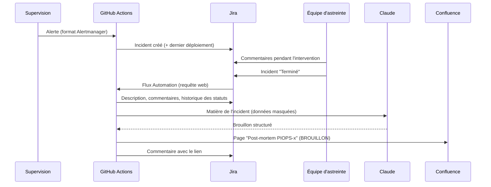

# 📚 Brique 4 : de l'alerte au post-mortem

## Ce que ça fait

| Moment | Ce qui se passe |
|---|---|
| La supervision lève une alerte | Un **incident** est créé dans Jira : gravité, service, procédure, et **dernier déploiement** (souvent la première piste). Une alerte qui se répète commente l'incident ouvert au lieu d'en créer un autre |
| L'équipe intervient | Elle commente l'incident : la chronologie se construit au fil de l'eau |
| L'incident passe **Terminé** | L'IA rédige un **brouillon de post-mortem** dans Confluence (statut "BROUILLON À RELIRE") et commente l'incident avec le lien |

Le brouillon contient : résumé, impact, durée (**calculée par le code**), chronologie, **cause probable avec un niveau de confiance**, facteurs contributifs, ce qui a bien fonctionné, ce qui est à améliorer, **actions correctives proposées** (prévention, détection, réponse) et **questions ouvertes** pour la revue.

> [!IMPORTANT]
> **Principe "blameless"** (sans recherche de coupable) : l'IA décrit des rôles, jamais des personnes, et les noms des auteurs Jira sont retirés par le code s'il en reste. **Aucun ticket d'action n'est créé** : l'équipe choisit en revue lesquels ouvrir.

## Comment ça circule



## Mise en place

### 1. Projet d'incidents

Sur notre sandbox, Jira Service Management n'est pas activé : les incidents vivent dans un projet **Jira Software** dédié, **POC IA - Exploitation** (clé `PIOPS`, modèle Kanban), comme tickets "Bug" portant le label `incident`.

Le jour où JSM est disponible, on bascule sans toucher au code : variables `INCIDENT_PROJECT_KEY` (projet JSM) et `INCIDENT_ISSUE_TYPE` (`Incident`).

### 2. Page parente Confluence

Une page **Post-mortems** dans l'espace POC IA.

### 3. Variables GitHub

| Nom | Valeur |
|---|---|
| `INCIDENT_PROJECT_KEY` | `PIOPS` |
| `CONFLUENCE_POSTMORTEM_PARENT` | `Post-mortems` |
| `INCIDENT_ISSUE_TYPE` | *(facultatif, défaut `Bug`)* |

### 4. Flux Jira Automation "incident résolu" (dans le projet PIOPS)

| Étape | Réglage |
|---|---|
| Déclencheur | **Ticket transitionné**, vers le statut **Terminé** |
| Condition | **Étiquettes** contient `incident` |
| Action | **Envoyer une requête web** : mêmes URL, méthode et en-têtes que le flux de triage de la brique 1 |
| Corps (données personnalisées) | voir ci-dessous |

```json
{
  "event_type": "jira-incident-resolved",
  "client_payload": { "issue_key": "{{issue.key}}" }
}
```

Nom : `IA - Post-mortem à la résolution`.

### 5. Brancher une vraie supervision (chez un client)

Alertmanager, Grafana, CloudWatch ou Datadog envoient un webhook à un petit relais (fonction serverless) qui appelle l'API GitHub `repository_dispatch` avec `event_type: alert-fired` et l'alerte dans `client_payload.alert`. Pour un format autre qu'Alertmanager, seule la fonction `parse_alert` est à adapter.

## Rejouer la démo

1. **Actions > Brique 4 - Alerte vers incident > Run workflow**, scénario `memoire-saturee`, chronologie cochée : l'incident est créé avec la chronologie fictive de l'astreinte.
2. Ouvrir l'incident dans Jira, montrer le contexte (dernier déploiement) et les commentaires.
3. Passer l'incident à **Terminé**.
4. Environ 1 à 2 minutes plus tard : commentaire avec le lien, et page **Post-mortem PIOPS-x** dans Confluence.

*Pour rejouer le post-mortem seul :* Actions > Brique 4 - Post-mortem IA > Run workflow > clé de l'incident.

## Adapter à un client

| Situation | Adaptation |
|---|---|
| Jira Service Management disponible | `INCIDENT_PROJECT_KEY` et `INCIDENT_ISSUE_TYPE=Incident` ; les SLA et l'astreinte JSM s'ajoutent sans code |
| Outil d'astreinte (JSM Operations, PagerDuty...) | Il reste la source des alertes ; le relais transmet l'alerte au format attendu |
| Modèle de post-mortem maison | Modifier `ai_core/prompts/postmortem.md`, son schéma et la mise en page dans `scripts/postmortem.py` |
| Créer automatiquement les tickets d'action | Possible après validation par l'équipe ; déconseillé par défaut (l'IA propose, l'équipe décide) |
